# Gebruikershandleiding ONS Agendahulp

## Over deze handleiding

De Agendahulp is een uitbreiding voor Chrome en Edge die je helpt in ONS
Agenda. Hij vult afspraken en registraties voor je in, kleurt je dagindeling,
houdt bij welke tijd nog geregistreerd moet worden en zoekt vrije tijd voor
nieuwe afspraken. Deze handleiding legt uit hoe je hem installeert, instelt en
gebruikt.

De schermafbeeldingen in deze handleiding zijn gemaakt met nepgegevens. Namen
zoals Tamara Test bestaan niet.

## 1. Installeren

Hoe de Agendahulp op je computer komt, bepaalt je organisatie.

- **Via IT.** Meestal wordt de extensie automatisch voor je geïnstalleerd.
  Na een herstart van de browser staat hij erin. Je hoeft niets te doen.
- **Via de winkel.** Open [INVULLEN: link naar de Chrome Web Store of Edge
  Add-ons] en kies **Toevoegen**.
- **Als tester.** Pak het ZIP-bestand uit in een vaste map. Ga naar
  `chrome://extensions` (of `edge://extensions`), zet **Ontwikkelaarsmodus**
  aan, kies **Uitgepakte extensie laden** en selecteer de map.

Zet het icoon vast in de werkbalk: klik op het puzzelstukje rechtsboven in de
browser en daarna op de punaise naast ONS Agendahulp. Op het icoon staat een
getal: het aantal dagen waarop nog tijd openstaat om te registreren.

## 2. Instellen in de popup

Klik op het icoon van de Agendahulp. In de popup stel je eenmalig in:

1. **Bedrijfsonderdeel en team.** Kies waar je werkt. De agenda kleurt dan
   volgens de dagindeling van jouw team.
2. **Werktijden** (optioneel). Met **Instellen** vul je per werkdag in of je
   werkt en van hoe laat tot hoe laat. Kort typen mag: `9` wordt 09:00,
   `1230` wordt 12:30. De kleuren in je agenda en de Planhulp houden rekening
   met je werktijden. **Wissen** zet ze terug naar de dagindeling van je team.
3. **Wekelijkse herinnering** (optioneel, standaard uit). Aan: elke vrijdag
   om 15:00 een melding als er nog tijd openstaat. De browser vraagt eerst of
   de extensie meldingen mag tonen.

Onderaan de popup staat **Probleem melden via TOPdesk**.

Je keuzes gaan mee naar andere computers waarop je met hetzelfde
browseraccount werkt.

## 3. In ONS

Open ONS Agenda (`https://impegno.onsagenda.nl`). Stond ONS al open toen de
extensie werd geïnstalleerd of bijgewerkt, herlaad dan de pagina. Linksonder
staat dan een kaartje met **Pagina herladen**.

### 3.1 Gekleurde dagindeling

Je agenda krijgt de kleuren van de dagindeling van je team, binnen je
werktijden. Per dag zie je hoeveel tijd er nog geregistreerd moet worden.
Wat de kleuren betekenen, staat in het zijpaneel onder het i-tje.

### 3.2 Afspraakhulp

Maak je in ONS een nieuwe afspraak, dan verschijnt de afspraakhulp in het
formulier. Je kiest het afspraaktype; de hulp vult daarna voor je in:

- het label (of de labels) bij dat type;
- de titel, met het type en de voornamen van de cliënten;
- de duur en de eindtijd;
- bij een huisbezoek de reistijd heen en terug;
- per cliënt de uursoort.

Voeg je later een cliënt toe, dan vraagt de hulp alleen wat er voor die
cliënt nog ontbreekt. Zet je **Afspraak doorplannen?** uit, dan zet de hulp
de herhaling terug op Niet. Met **Verwijder instellingen** maak je de velden
weer leeg. Daarna sla je de afspraak zoals altijd op in ONS.

Bij een afspraak zonder cliënt (niet-cliëntgebonden, bijvoorbeeld een
teamoverleg) kies je de soort; de hulp zet de uursoort op de afspraak zelf.

### 3.3 Registratiehulp

Registreer je vanuit een afspraak, dan helpt de registratiehulp:

1. Hij kiest de **registratievorm** die bij het label van de afspraak hoort
   (of je kiest hem zelf).
2. Hij verdeelt de tijd over **direct en indirect** volgens die vorm. Vraagt
   de vorm naar indirecte tijd, dan beantwoord je eerst die vraag.
3. Als de vorm erom vraagt, kies je de **reistijd**.
4. Hij zet de **aanhef** van de rapportage, als die nog leeg is.
5. Ontbreekt de **uursoort**, dan kies je die in de hulp.
6. Onderin staan de **controles**: rapportage geschreven, uursoort gekozen,
   direct en indirect samen gelijk aan de duur. Pas als alles klopt, wordt
   **Indienen** actief.

Is de cliënt niet gekomen, gebruik dan **No show**.

### 3.4 Rechtermuisknop

Klik in ONS met de rechtermuisknop:

- **Registreren als…** met een registratievorm: opent een registratie met
  die vorm, ook zonder afspraak.
- **Agendahulp in zijpaneel**: opent het zijpaneel.

### 3.5 Het zijpaneel openen

Klik op het roze lipje aan de rechterrand van ONS, of gebruik de
rechtermuisknop, **Agendahulp in zijpaneel**. Het zijpaneel staat naast ONS
en volgt het ONS-tabblad in hetzelfde venster.

## 4. Het zijpaneel

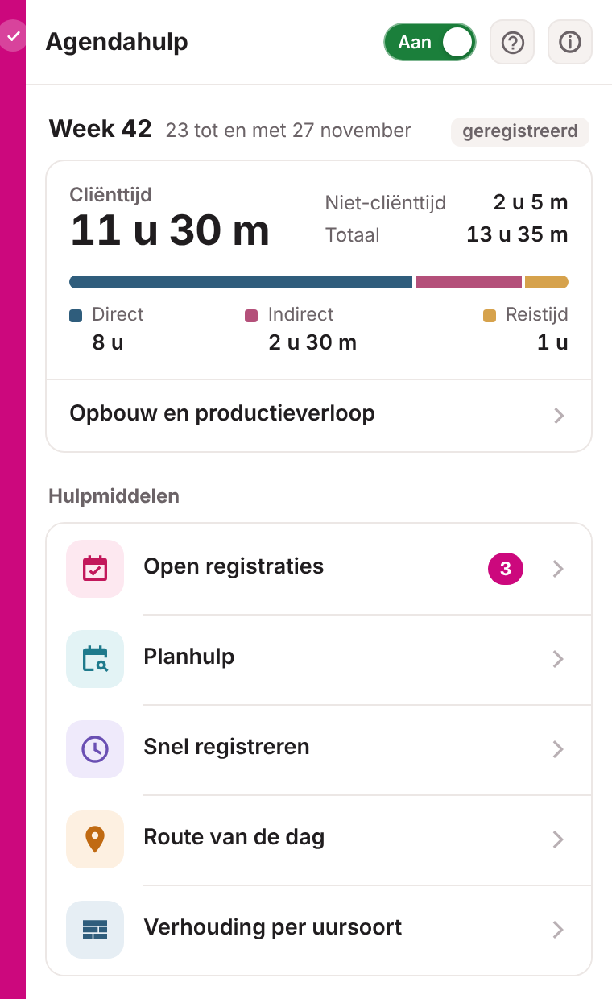

Bovenin staan drie knoppen:

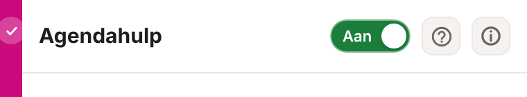

- **Aan / Uit** zet de hulp in ONS aan of uit. Uit werkt ONS gewoon zoals
  altijd.
- Het **vraagteken** start de rondleiding van het scherm waar je bent.
- Het **i-tje** toont wat de kleuren in ONS betekenen, je werktijden en de
  versie.

Het startscherm toont je **week**: de cliënttijd groot, de niet-cliënttijd en
het totaal klein, en een balk met direct (blauwgrijs), indirect (oud roze) en
reistijd (oker). Met **Opbouw en productieverloop** ga je naar de details.
Daaronder staan de **hulpmiddelen**. Bij Open registraties staat hoeveel
afspraken nog open staan.

Onderaan het zijpaneel staat **Verlof aanvragen** (zie hoofdstuk 11).

## 5. Planhulp: vrije tijd zoeken

De Planhulp zoekt in je agenda tijd waarin een nieuwe afspraak helemaal past,
binnen je werktijden.

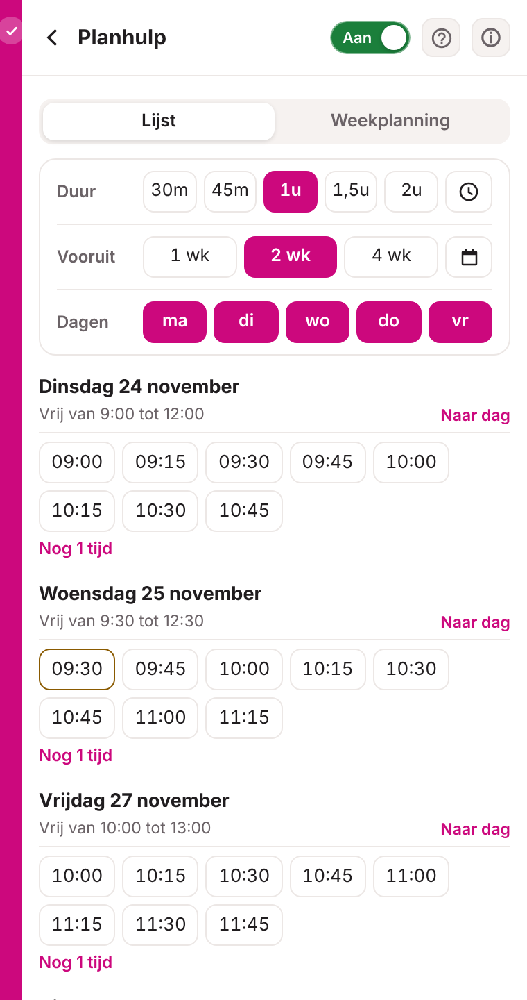

### 5.1 Instellingen

- **Lijst of Weekplanning**: de lijst toont per dag de begintijden; de
  weekplanning toont je week als kleine agenda.
- **Duur**: 30m, 45m, 1u, 1,5u of 2u. Met het **klokje** kies je een eigen
  duur: min en plus gaan per kwartier, en als je op de duur tikt, typ je hem
  zelf, tot op de minuut (bijvoorbeeld `1:07`, `0:20` of `2,5`). Van 5
  minuten tot 8 uur.

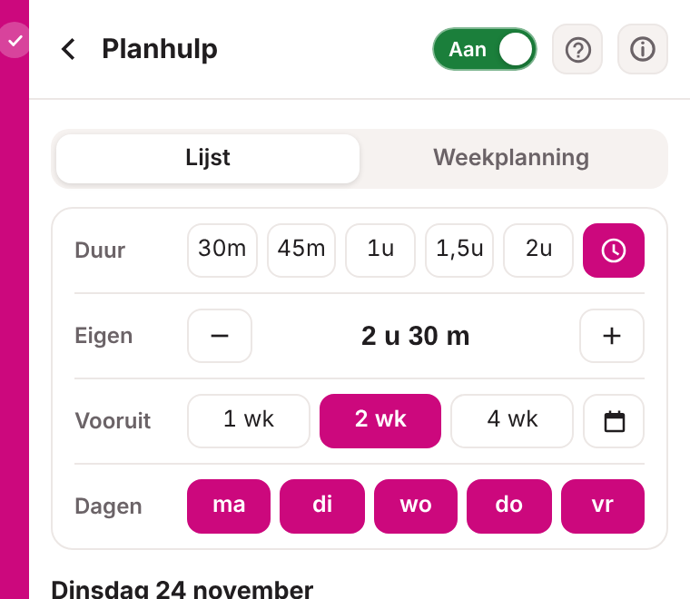

- **Vooruit**: 1, 2 of 4 weken, of met het kalendertje tot een datum die je
  kiest.
- **Dagen**: vink dagen uit waarop je niet wilt plannen.

### 5.2 Momenten kiezen in de lijst

Tik op een begintijd om hem te kiezen; nog een tik laat hem los. Je kunt
meerdere momenten kiezen, ook op verschillende dagen. ONS kijkt meteen na of
er op dat moment al iets staat; dan krijgt de tijd een oranje rand met een
melding. **Naar dag** opent die dag in je agenda. **Nog x tijden** toont de
rest van de dag, **Meer laden** zoekt een week verder.

Je gekozen momenten staan onderin. Tik op de teller om ze te bekijken, er een
weg te halen of alles te wissen.

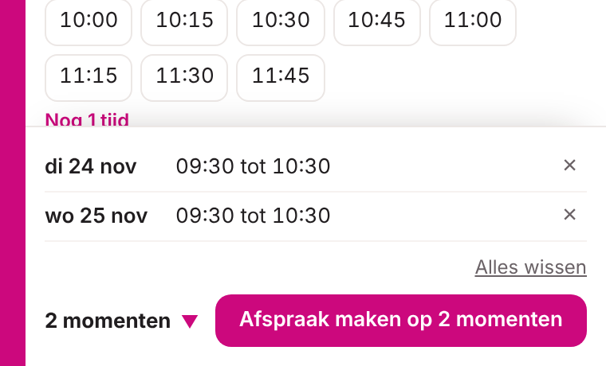

### 5.3 Weekplanning

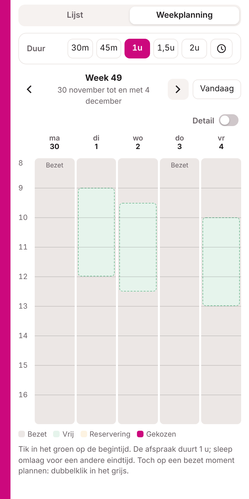

Groen is vrij, grijs bezet, oranje een reservering, roze gekozen. Vandaag
heeft een roze kop; een roze lijn toont het huidige tijdstip. Met de pijlen
blader je door de weken, met **Vandaag** ben je terug in deze week.

- **Klikken** in het groen kiest die begintijd met de ingestelde duur.
- **Klikken en slepen**: druk op een begintijd en sleep omlaag. De eindtijd
  loopt per kwartier mee. Laat los en het moment heeft die duur. Sleep je
  door tot in bezette tijd, dan wordt het blok oranje en staat er onder de
  week een melding, bijvoorbeeld "je bent bezet vanaf 13:00".
- **Dubbelklik** in het grijs (of op een afspraak) om daar toch te plannen.

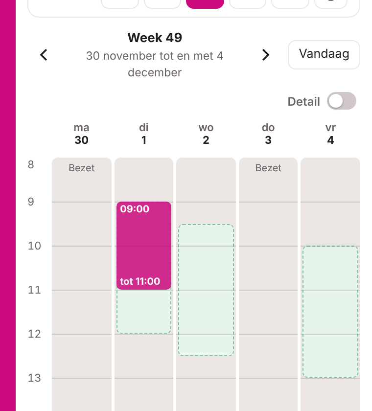

Met **Detail** zie je ook je afspraken zelf, met het label of
"Cliëntafspraak". Eén dag staat dan open; tik op een smalle dag om die open
te klappen.

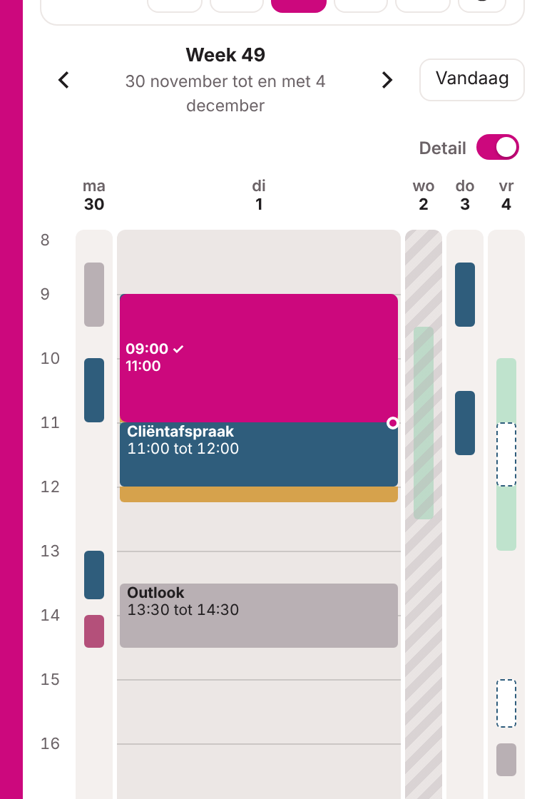

### 5.4 Verder naar Afspraak maken

Tik onderin op **Afspraak maken** (of **Afspraak maken op n momenten**). Je
gaat naar het scherm Afspraak maken.

## 6. Afspraak maken

Hier maak je de afspraken op de gekozen momenten meteen in ONS.

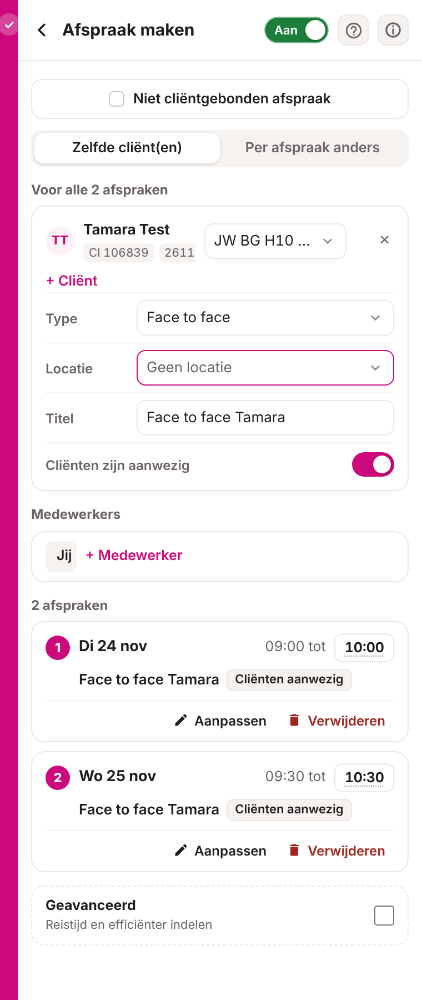

### 6.1 Wat je kiest

- **Niet cliëntgebonden afspraak**: aan voor een afspraak zonder cliënt; dan
  kies je alleen de uursoort.
- **Zelfde cliënt(en) of Per afspraak anders**: bij meerdere momenten krijgt
  elke afspraak dezelfde cliënten, of kies je per afspraak.
- **Cliënt**: typ een naam zoals in ONS. Je ziet het cliëntnummer, de
  geboortedatum en de postcode. Met het vinkje **Inclusief cliënten uit
  zorg** zoek je ook cliënten die uit zorg zijn. Met **+ Cliënt** voeg je er
  een toe.

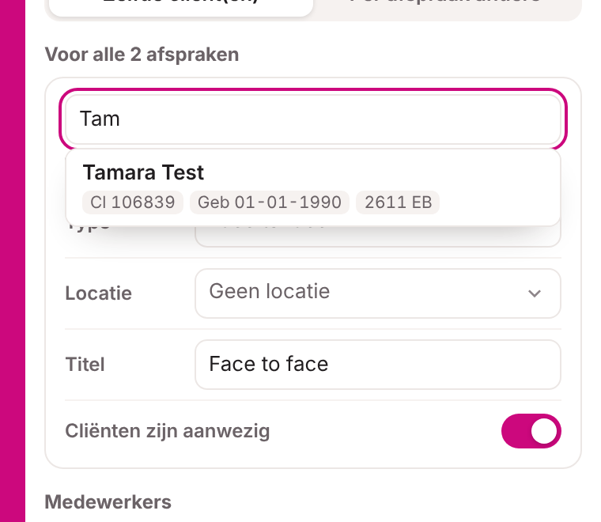

- **Uursoort** per cliënt. Bovenaan de lijst staat **Geen uursoort**; die is
  nooit vooraf gekozen. Zolang er geen keuze is, staat er een rood
  uitroepteken.

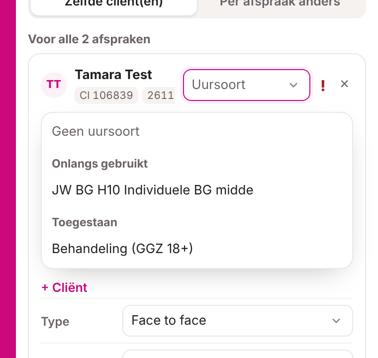

- **Type**, **Locatie** (uit ONS, of **Andere locatie** met een eigen
  tekst), **Titel** (standaard type en voornamen) en **Cliënten zijn
  aanwezig**. Bij een huisbezoek ook de **reistijd** heen en terug.
- **Medewerkers**: met **+ Medewerker** zet je een collega erbij. De hulp
  kijkt per afspraak of die collega dan kan. Kan hij niet, dan kies je
  **Toch inplannen** of zonder die collega.

### 6.2 De afspraken zelf

Elke afspraak heeft een eigen kaart met de dag en de tijd. Tik op de
**eindtijd** om hem te typen (bijvoorbeeld `1130`) en druk op Enter; Escape
laat hem zoals hij was. Loopt de afspraak door tot in bezette tijd, of
overlapt hij een andere afspraak op dit scherm, dan zie je dat meteen. Dat is
een waarschuwing: maken kan gewoon.

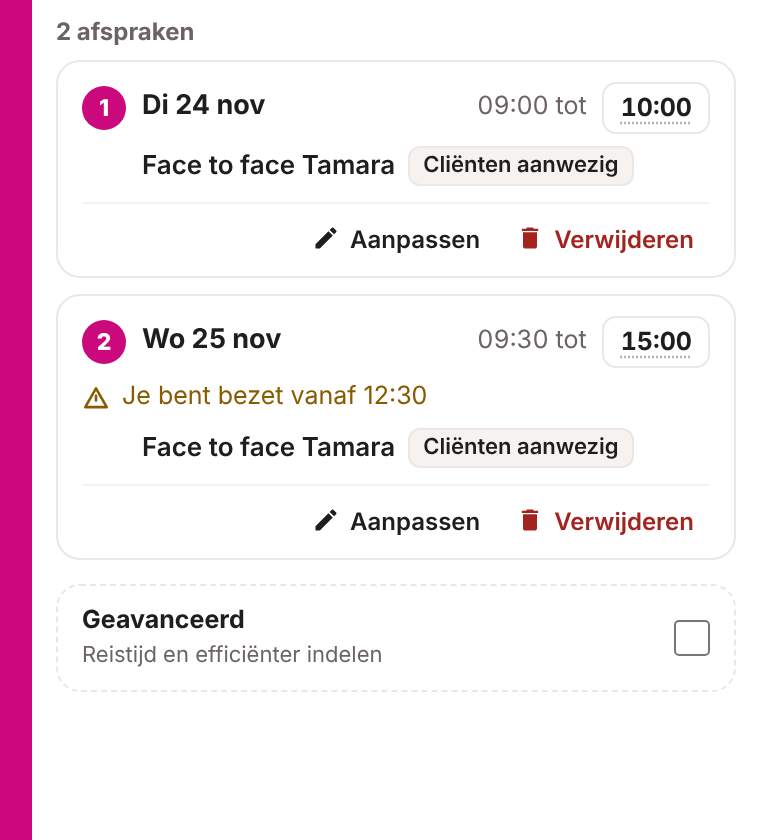

Met **Aanpassen** kies je voor één afspraak iets anders (type, locatie,
titel, aanwezig, reistijd). Met **Verwijderen** haal je een afspraak weg; de
browser vraagt eerst "Weet je het zeker?".

### 6.3 Geavanceerd

Met het vinkje **Geavanceerd** pas je per afspraak de reistijd aan en vind je
**Efficiënter indelen**: de hulp stelt een volgorde voor met minder rijtijd.
Dat werkt alleen als je beheerder een sleutel voor Google heeft ingesteld; er
gaan dan alleen postcodes naar Google.

### 6.4 Maken

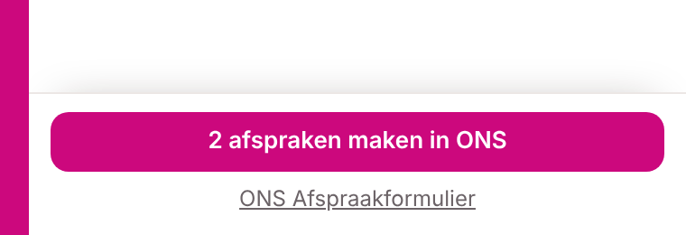

- **n afspraken maken in ONS** maakt alles meteen. Dat kan pas als elke
  cliënt een uursoort heeft (of Geen uursoort).
- **ONS Afspraakformulier** opent liever het formulier van ONS, met datum,
  tijden, type en uursoort al ingevuld. Na het opslaan maakt de hulp de
  afspraak ook op de andere momenten.

## 7. Open registraties

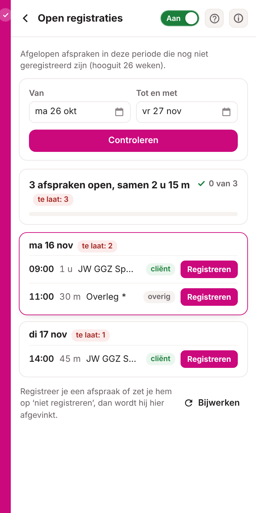

Kies een periode (hooguit 26 weken) en tik op **Controleren**. Per dag zie je
de afgelopen afspraken die nog niet geregistreerd zijn; te laat staat erbij.
Met **Registreren** opent de registratie van die afspraak in ONS.

Dit is een afwerklijst: registreer je een afspraak of zet je hem op niet
registreren, dan wordt hij afgevinkt. **Bijwerken** kijkt meteen opnieuw.

## 8. Snel registreren

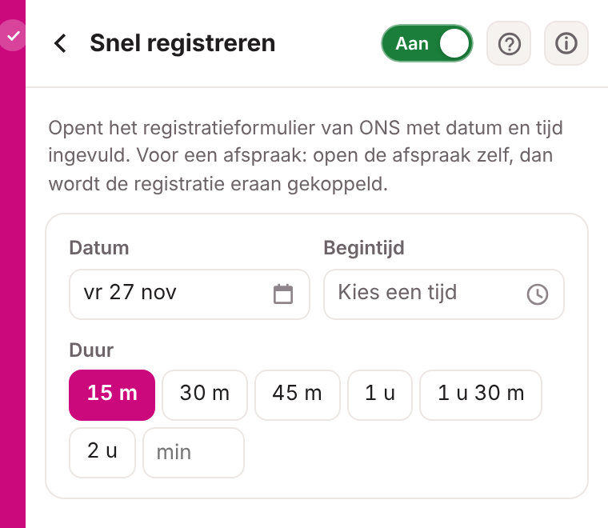

Voor tijd zonder afspraak, zoals overleg of verslaglegging. Kies de datum,
de begintijd en de duur (of typ een aantal minuten) en tik op
**Formulier openen**. Het registratieformulier van ONS opent met alles
ingevuld. Overlapt het met een andere registratie, dan zie je dat eerst en
kies je **Toch openen**.

Wil je registreren bij een afspraak, open dan de afspraak zelf; dan wordt de
registratie eraan gekoppeld.

## 9. Route van de dag

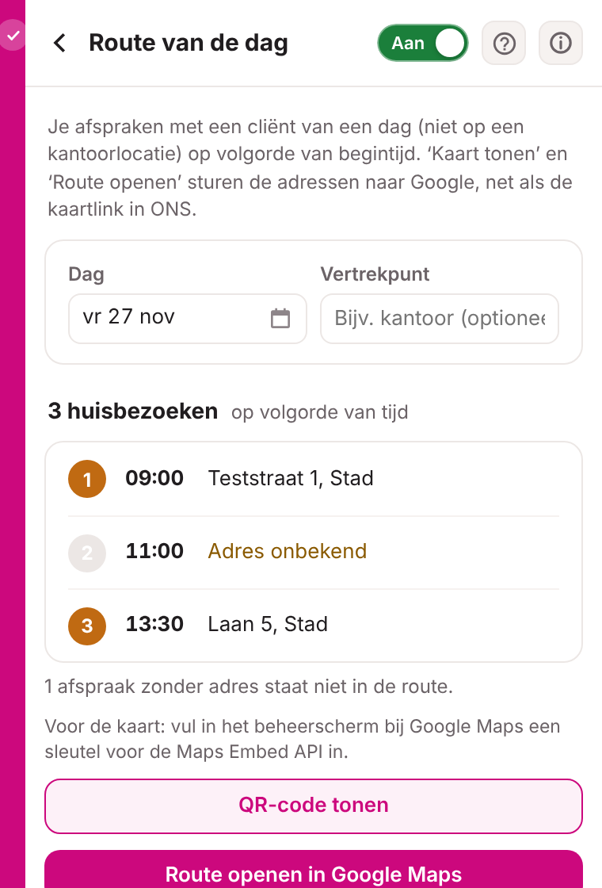

Je huisbezoeken van een dag op volgorde van begintijd. Kies de dag en vul
eventueel een **vertrekpunt** in, zoals je kantoor; dat onthoudt het
zijpaneel.

- **Route openen** opent de hele route in Google Maps.
- **Kaart tonen** laat de route op een kaart in het zijpaneel zien.
- **QR-code tonen**: scan hem met je telefoon en je hebt de route bij je.

Let op: bij Route openen en Kaart tonen gaan de adressen van die dag naar
Google, net als bij de kaartlink in ONS. Dat gebeurt pas als je erop klikt.

## 10. Cliënttijd en Verhouding per uursoort

**Cliënttijd** (via Opbouw en productieverloop op het startscherm) toont de
opbouw van je week en het **productieverloop**: je directe, indirecte en
reistijd per week over een periode die je kiest, als grafiek en tabel.
Weken in de toekomst komen uit je planning.

Boven de grafiek staat het **Totaal geregistreerd** tussen je gekozen datums,
op de dag precies: je cliënttijd, verdeeld over direct, indirect en reistijd,
je niet-cliënttijd en het totaal. Loopt de periode door na vandaag, dan telt
alleen wat je tot en met vandaag hebt geregistreerd.

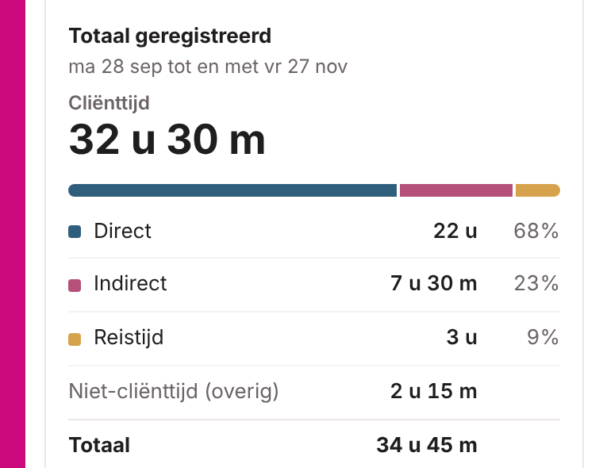

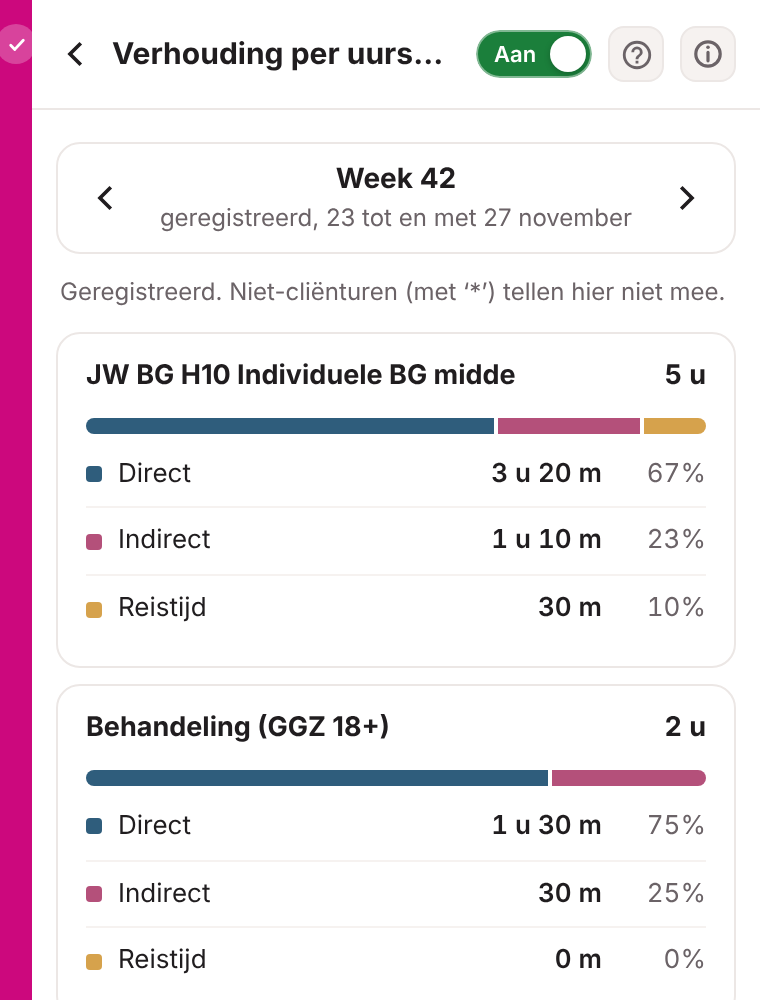

**Verhouding per uursoort** toont per uursoort hoeveel tijd je in een week
hebt, verdeeld over direct, indirect, reistijd en overig. Blader met de
pijlen naar een andere week. Toekomstige weken tonen wat gepland staat.

## 11. Verlof aanvragen

Onderaan het zijpaneel staat **Verlof aanvragen**. Je vult in wat je ook in
ONS bij Onbeschikbaarheid invult: omschrijving, datum, begin- en eindtijd of
hele dag, en eventueel een herhaling. Bij opslaan zet de hulp de
onbeschikbaarheid in je ONS-agenda en opent hij AFAS in een nieuw tabblad,
waar je het verlof aanvraagt.

## 12. Rondleidingen en hulp

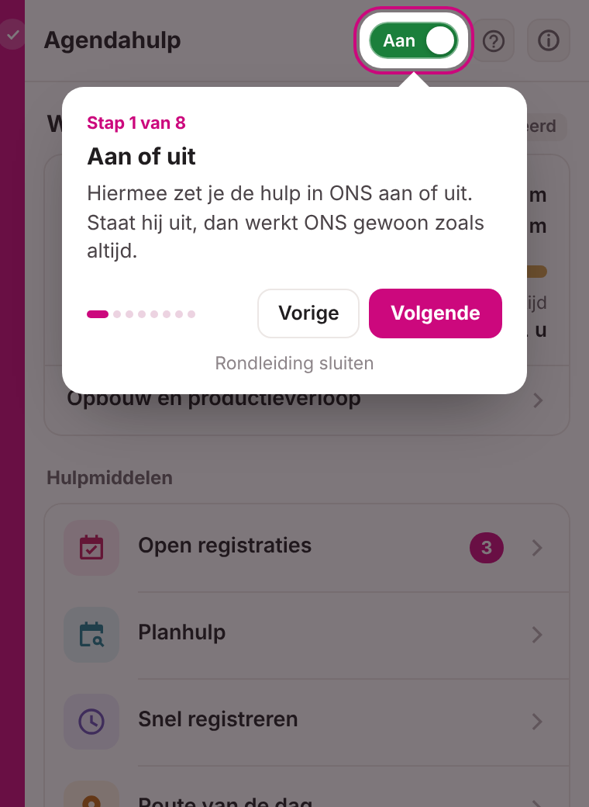

Elk scherm heeft bovenin een **vraagteken** met een korte rondleiding van dat
scherm. De rondleiding van het startscherm opent vanzelf bij elke nieuwe
versie. Je bladert met **Volgende** en **Vorige** (of de pijltjestoetsen);
**Rondleiding sluiten** of Escape stopt.

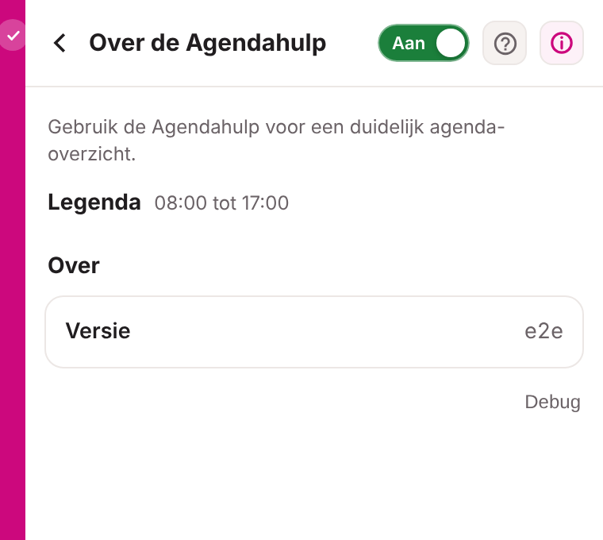

Onder het **i-tje** staan de legenda van de kleuren, je werktijden en de
versie.

## 13. Privacy in het kort

- De hulp werkt binnen ONS, met jouw eigen sessie. Hij bewaart nooit namen,
  cliëntnummers of geboortedata.
- Op je computer onthoudt hij alleen je keuzes (team, werktijden,
  herinnering, vertrekpunt) en getallen voor de herinnering.
- Naar Google gaat alleen iets als je beheerder dat heeft ingesteld: postcodes
  voor rijtijden, en de adressen van één dag als je zelf op Route openen of
  Kaart tonen klikt.
- Geen statistieken, geen tracking, geen reclame.

Meer: zie het document "Waarom de Agendahulp deze permissies vraagt".

## 14. Problemen oplossen

**Ik zie de hulp niet in ONS.** Kijk of het adres klopt
(`impegno.onsagenda.nl`), herlaad de pagina en kijk of de schakelaar in het
zijpaneel op Aan staat. Werkt het nog niet, meld het dan.

**Linksonder staat Pagina herladen.** De extensie is bijgewerkt terwijl ONS
openstond. Klik erop.

**Het zijpaneel zegt "Geen ONS-scherm open" of "Niet in ONS".** Open ONS
Agenda in hetzelfde venster en ga naar de agenda.

**Het zijpaneel zegt "De ONS-pagina reageert niet".** Herlaad de ONS-pagina.

**De kleuren kloppen niet.** Kies in de popup het juiste team. Kleurt een dag
niet, kijk dan bij Werktijden of die dag aangevinkt is.

**De Planhulp vindt geen tijd.** Kies een kortere duur, zoek verder vooruit
of kijk bij Dagen.

**Bij Verwijderen staat "Voorkomen dat deze pagina extra dialoogvensters
maakt".** Vink dat niet aan; anders werkt Verwijderen niet meer. Gebeurd?
Sluit het zijpaneel en open het opnieuw.

**De herinnering komt niet.** Kijk in de popup of hij aanstaat en of de
browser meldingen mag tonen. Stond de browser vrijdag om 15:00 dicht, dan
komt de melding bij de volgende start.

**Melden.** Via **Probleem melden via TOPdesk** in de popup. Zet erbij welke
versie je hebt (i-tje), wat je deed en wat je zag, met een schermafdruk
zonder cliëntgegevens.
