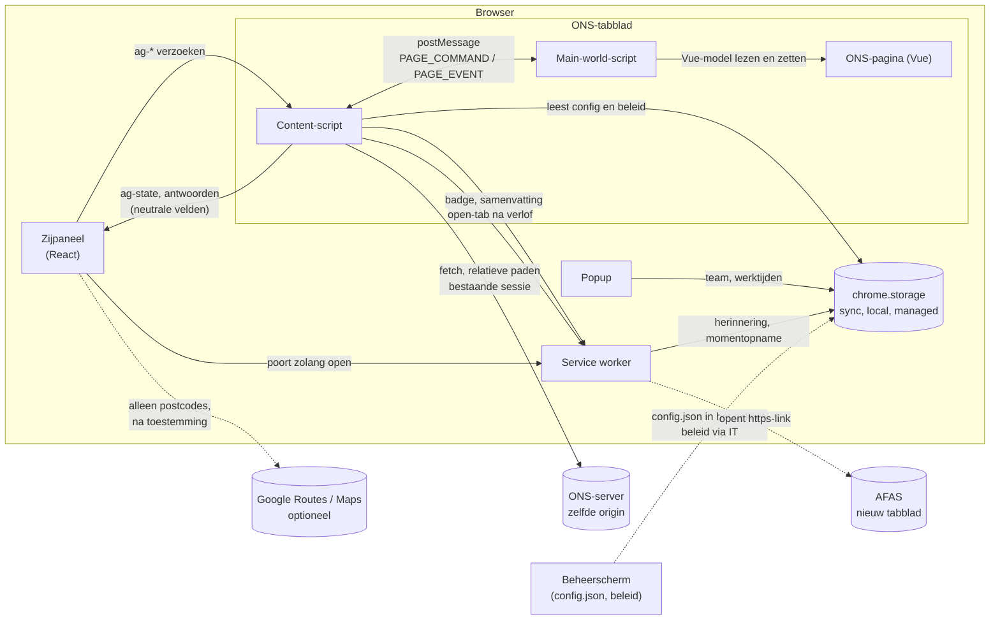

# Architectuuroverzicht (beknopt)

De ONS Agendahulp is een Manifest V3-extensie voor Chrome en Edge (vanaf
versie 116). Hij draait bovenop ONS Agenda en ONS Dossier
(`impegno.onsagenda.nl`, `impegno.ons-dossier.nl`) en helpt bij afspraken,
registraties en het overzicht van de week. Het volledige verhaal staat in
[../ARCHITECTURE.md](../ARCHITECTURE.md); dit is de korte versie.

## Onderdelen

| Onderdeel | Bestand(en) | Draait in | Taak |
|---|---|---|---|
| Manifest | `manifest.json` | browser | Rechten, content-scripts, zijpaneel, popup, service worker |
| Service worker | `dist/background.js` (bron `src/background/`) | achtergrond | Getal op het icoon, momentopname van de week, wekelijkse herinnering, rechtermuismenu, zijpaneel openen |
| Content-script | `dist/content.js` (bron `src/content/`) | ONS-pagina's, geïsoleerde wereld | Afspraak- en registratiehulp, gekleurde dagindeling, alle aanroepen naar ONS, antwoorden aan het zijpaneel |
| Wizardschermen | `dist/react-bundle.js` (bron `src/react/`) | ONS-pagina's | De schermen van de hulp op de ONS-pagina (React) |
| Main-world-script | `dist/main-world.js` (bron `src/main-world/`) | ONS-pagina, pagina-context | Lezen en zetten van formuliervelden via Vue van ONS |
| Lipje | `dist/edge-tab.js` (bron `src/edge-tab/`) | ONS-pagina's | Het roze lipje aan de rechterrand dat het zijpaneel opent |
| IO-planning | `dist/io-planning-block.js` | `*.ioservice.net` | Schakelt de knop "toevoegen" op de IO-planning uit |
| Zijpaneel | `pages/sidepanel.html`, `dist/sidepanel.js` (bron `src/sidepanel/`) | zijpaneel van de browser | Planhulp, Afspraak maken, Open registraties, Snel registreren, Route, Cliënttijd, Verhouding |
| Popup | `pages/popup.html`, `dist/popup.js` (bron `src/popup/`) | popup bij het icoon | Bedrijfsonderdeel en team, werktijden, herinnering, links |
| Opties | geen eigen optiepagina | | Instellingen per medewerker staan in de popup; centrale instellingen komen uit `config.json` en het beleid |
| Beheerscherm | `tools/beheer/beheer.html` | lokaal in de browser, niet in de extensie | Maakt `config.json` en de beleidsinstellingen |
| Gedeelde code | `src/shared/` | in elke bundel | Berichttypes, opslagsleutels, hosts, versie, datums, veilige HTML |

Broncode staat in `src/`; de browser laadt alleen `dist/` (gebouwd met
esbuild), plus `manifest.json`, `config.json`, `pages/`, `icons/` en `assets/`.

## Datastroom

## Hoe een verzoek loopt (voorbeeld: vrije tijd in de Planhulp)

1. Het zijpaneel stuurt `ag-free-slots` met duur en periode naar het
   content-script van het actieve ONS-tabblad (`chrome.tabs.sendMessage`).
2. Het content-script haalt de weekgegevens op bij ONS via
   `services/ons-api/http.js`: relatieve paden, dezelfde origin, de bestaande
   sessie van de medewerker.
3. Het antwoord van ONS wordt gecontroleerd (`formaat.js`, valibot) en
   teruggebracht tot neutrale velden (tijden, soort, label). Namen,
   cliëntnummers en geboortedata gaan niet mee.
4. Het content-script rekent de vrije blokken uit en stuurt ze terug; het
   zijpaneel tekent de lijst of de weekplanning.

## Configuratie in lagen

De configuratie wordt bij elke wijziging opnieuw opgebouwd
(`config/app-config.js`, `bouwConfig`):

`standaardwaarden` < `config.json` (in het pakket) < lokale testconfig (alleen
het testpakket) < beleid (`chrome.storage.managed`, gezet door IT).

## Regels die de opbouw bewaken

- `npm run check`: manifest en pagina's verwijzen alleen naar bestaande
  bestanden, onderdelen delen code alleen via `src/shared/`, en de lagen van
  het content-script importeren alleen naar beneden.
- CI faalt als de gecommitte `dist/` niet overeenkomt met `src/`.
- Netwerk alleen via `services/ons-api/http.js`, met relatieve paden op de
  ONS-origin. De enige verbindingen naar buiten zijn Google Routes en Maps
  vanuit het zijpaneel (zie [permissies-en-opslag.md](permissies-en-opslag.md)).
